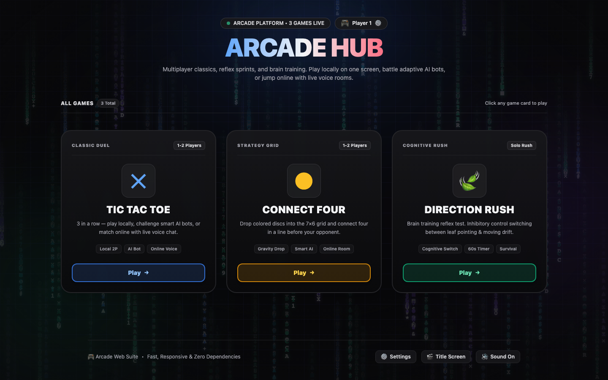
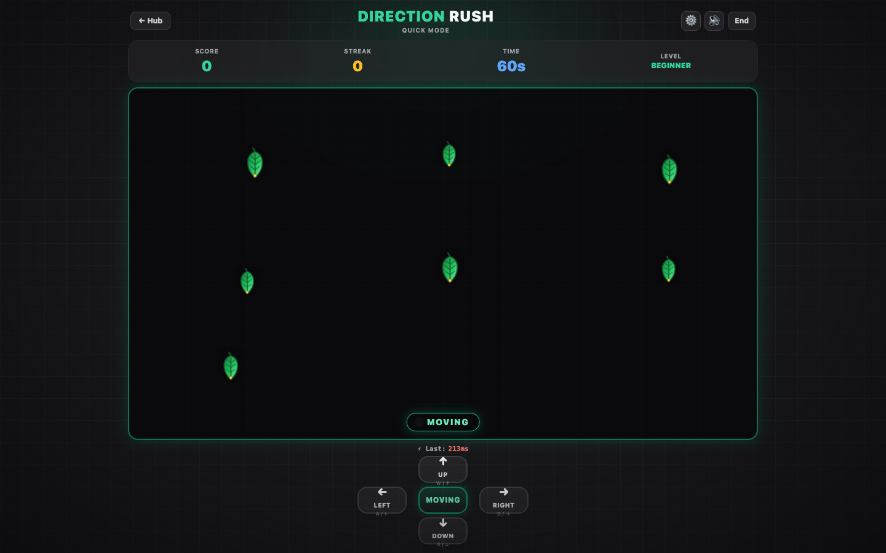
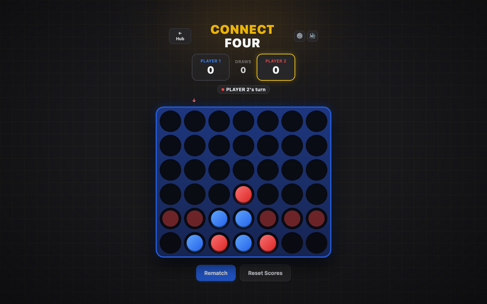
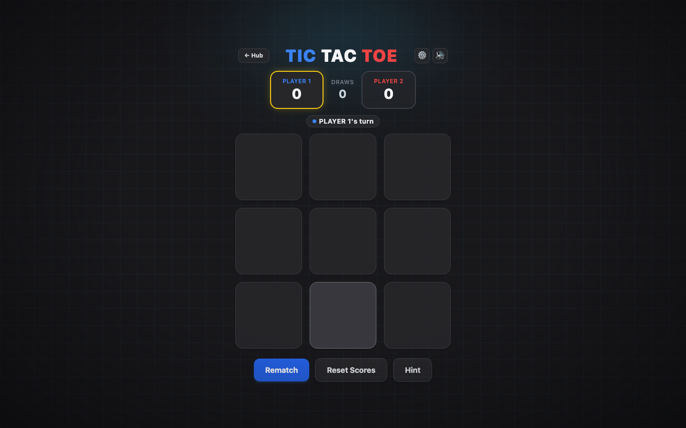
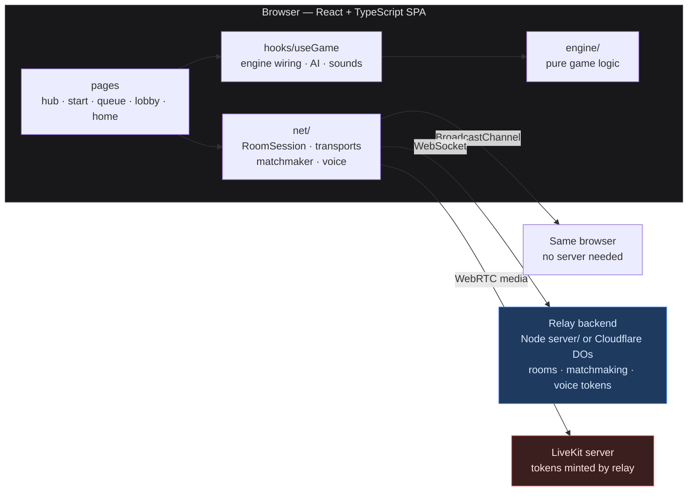

# Arcade Hub

[](https://github.com/nahyan0077/arcade-hub/actions/workflows/ci.yml)
[](LICENSE)

> 🎮 **Live Arcade**: [https://arcade-hub-relay.arcade-hub.workers.dev](https://arcade-hub-relay.arcade-hub.workers.dev)

A modern, responsive browser **arcade game platform** featuring **Tic-Tac-Toe**, **Connect Four**, and **Direction Rush** on one shared stack. Play local hot-seat, face adaptive AI opponents, train reflexes with cognitive speed runs, or go online with private room codes, instant Quick Play matchmaking, in-game chat, and real-time voice chat. Built test-first on a game-scoped networking architecture and zero-scroll responsive UI design system.

<p align="center">
  
  &nbsp;
  
</p>
<p align="center">
  
  &nbsp;
  
</p>

## Contents

- [Features](#features)
- [Games](#games)
- [Quick start](#quick-start)
- [Scripts](#scripts)
- [Architecture](#architecture)
- [Configuration](#configuration)
- [Testing](#testing)
- [Known limitations](#known-limitations)
- [Roadmap](#roadmap)
- [Contributing](#contributing)

## Features

- **Retro Cyber Aesthetics** — animated 3D perspective cyber grids (`RetroGrid`) themed per game (cyan, amber, emerald, purple) with ambient glowing horizons.
- **Unified GameShell** — consistent arcade navigation header, persistent audio controls, settings drawer, and zero-scroll layout budgeting across all games.
- **Responsive Viewport Fitting** — engineered to fit any screen without scrolling or button clipping (mobile portrait, short tablet landscape `800x550`, desktop `1440x900+`).
- **Profile & Handle Synchronization** — custom player handles set in Profile Settings seamlessly propagate across start screens, lobby matchmaking, and live game scoreboards (`(YOU)` badge clarity).
- **2-Player local** — hot-seat play with persistent X/O/draw and win-count scores.
- **Online rooms & Quick Play** — create/join with 6-character codes over WebSocket or BroadcastChannel, plus instant 1v1 matchmaking, auto-reconnect resilience, and move self-healing.
- **Interactive Turn Feedback** — real-time turn guidance and tactile notifications (`⏳ Waiting for opponent's move...`) eliminating dead-click confusion.
- **Live Voice Chat** — LiveKit-powered per-room audio behind icon controls (🎧 join, 🎤 mute, participant count badge), listen-only until you unmute.
- **Perspective results & Celebrations** — context-aware "You win!" / "You lose!" labeling with physics-based particle confetti on the winner's viewport.
- **In-game chat & emoji reactions** — slide-up chat drawer plus quick-reaction emoji bursts (🎉🔥😂👏💯😅🤔👀) synchronized across both clients.
- **Synthesized Web Audio** — programmatic sounds (placements, wins, errors, streaks, clicks) generated via the Web Audio API with zero external audio assets.

## Games

### 1. Tic-Tac-Toe
- Classic 3×3 duel with local 2P, smart AI bot personalities, and online room/voice play.
- **Coach hints** — mathematically best cell highlighted on request.
- **AI Tiers**:
  | Difficulty | Personality | Behavior |
  |-----------|-------------|----------|
  | Easy | GLITCH | Random moves (seeded RNG) |
  | Medium | SCOUT | Takes wins, blocks threats, prefers center |
  | Hard | VANGUARD | Minimax lookahead (depth 4) |
  | Impossible | NEMESIS | Unbeatable full minimax + alpha-beta pruning |

### 2. Connect Four
- 7×6 gravity board with column hover indicators and winning 4-in-a-row highlight lines.
- Local 2P, vs AI (Easy, Medium, Hard), and online multiplayer.
- Moves transfer deterministic column indices across WebSocket and BroadcastChannel transports.

### 3. Direction Rush
- Fast-paced cognitive reflex & inhibitory control game testing dual-rule switching speed.
- Dynamic stimuli: floating leaves that either point in one direction or drift in another.
- **In-Arena Rule Beacons** — high-visibility live badges (`POINTING` or `MOVING`) at the bottom of the arena with pulsing leaf tip beacons for instant readability.
- **Ergonomic Cross D-Pad** — standardized arcade cross layout (`UP` on top, `LEFT` / `CENTER` / `RIGHT` in the middle, `DOWN` at the bottom) supporting keyboard (`WASD` / arrow keys) and touch/mouse input.
- **Game Modes**:
  - **Quick Rush**: 60-second speed sprint.
  - **Survival**: 3 lives with penalty on incorrect answers.
  - **Infinite**: Zen practice without time limits.

## Quick start

```bash
npm install
npm run dev              # http://localhost:5173 — local and vs-AI work immediately
```

| Play mode | How |
|-----------|-----|
| Local hot-seat / vs AI | just `npm run dev` |
| Online, same browser | open two tabs — no `VITE_WS_URL` means in-browser BroadcastChannel (same profile and origin) |
| Online, across devices | `npm run relay`, then `VITE_WS_URL=ws://localhost:8787 npm run dev` |
| Cloudflare-style relay locally | `npm run relay:cf` (:8788) with `VITE_WS_URL=ws://localhost:8788` |
| Play live (hosted) | **https://arcade-hub-relay.arcade-hub.workers.dev** |
| Voice chat | see [Voice chat](#voice-chat) — needs LiveKit + a relay with `LIVEKIT_*` vars |

## Scripts

| Command | Description |
|---------|-------------|
| `npm run dev` | start dev server |
| `npm run build` | type-check + production build |
| `npm run lint` | ESLint |
| `npm test` | unit + integration tests (Vitest) |
| `npm run test:watch` · `test:ui` · `test:coverage` | Vitest variants |
| `npm run test:e2e` | Playwright E2E over BroadcastChannel (desktop + mobile) |
| `npm run test:e2e:ws` | E2E online + matchmaking over the Node WebSocket relay |
| `npm run test:e2e:cf` | E2E over the Cloudflare Durable Object relay (wrangler dev) |
| `npm run test:e2e:voice` | E2E voice session against a throwaway dockerized LiveKit |
| `npm run relay` | room relay server (ws, port 8787) |
| `npm run relay:cf` | Cloudflare Durable Object relay via wrangler dev (port 8788) |
| `npm run typecheck:cf` | type-check the Cloudflare worker |
| `npx wrangler deploy` | deploy worker + SPA assets to Cloudflare (after a build) |

## Architecture



Key decisions:

- **Pure-TS engine** — no React/DOM imports; exhaustively tested, reusable by future games
- **One `RoomTransport` interface** — the same `RoomSession` runs on BroadcastChannel, the
  Node relay, and Cloudflare Durable Objects
- **Dumb fan-out relays** — state lives in the clients (who validate moves); simple, but a
  tampered client can cheat (see [Known limitations](#known-limitations))
- **Game-scoped ids** — rooms, queues, and voice rooms are keyed `<game>:<code>`, so a second
  game reuses the whole networking stack

Full diagrams, HLD/LLD, data flows, and invariants: **[docs/ARCHITECTURE.md](docs/ARCHITECTURE.md)**.

### Project structure

```text
src/
  engine/        pure game logic — rules, minimax AI, personalities
    connect-four/   7×6 gravity engine + depth-limited AI (easy/medium/hard)
    direction-rush/ inhibitory control state machine, vector drifts, streaks
  net/           protocol · transports · RoomSession · matchmaker · voice
  hooks/         useGame · useConnectFour · useDirectionRush — engine wiring, AI, sounds, scores
  pages/         hub · start · queue · lobby · home · connect-four · direction-rush · landing
  components/    RetroGrid · GameShell · Board · ConnectFourBoard · ScoreBox · Confetti · VoiceControls · ChatPanel · QuickEmoji · EmojiBurstLayer
  sound/         Web Audio synth effects + persisted mute
  storage/       validated localStorage score persistence (per game key)
server/relay.ts  Node ws relay — room fan-out, /matchmake, /voice/token
cloudflare/      Worker + RoomRelay and Matchmaker Durable Objects
scripts/         LiveKit config + voice E2E orchestration
e2e/             Playwright specs (desktop Chromium + iPhone WebKit across mobile, tablet & desktop)
docs/            architecture guide + README images
```

## Configuration

| Env var | Default | Purpose |
|---------|---------|---------|
| `VITE_AI_DELAY_MS` | `600` | AI "thinking" delay before it moves |
| `VITE_WS_URL` | unset | WebSocket relay base URL; unset = in-browser BroadcastChannel |
| `RELAY_PORT` | `8787` | relay server port |
| `LIVEKIT_URL` | unset | LiveKit ws URL (e.g. `ws://127.0.0.1:7880`); unset disables voice (`503 voice-unconfigured`) |
| `LIVEKIT_API_KEY` / `LIVEKIT_API_SECRET` | unset | LiveKit API credentials for minting join tokens (secret ≥ 32 chars) |

### Voice chat

Voice is off by default: the room page hides voice controls without `VITE_WS_URL`, and the
relay returns `503 voice-unconfigured` unless the `LIVEKIT_*` vars are set. To enable locally:

1. Start a dev LiveKit server (the secret in `scripts/livekit.yaml` must be ≥ 32 characters):

   ```bash
   docker run --rm -p 7880:7880 -p 7881:7881/tcp -p 50000-50100:50000-50100/udp \
     -e NODE_IP=127.0.0.1 -v "$PWD/scripts/livekit.yaml":/lk/livekit.yaml:ro \
     livekit/livekit-server --config /lk/livekit.yaml
   ```

2. Export `LIVEKIT_URL=ws://127.0.0.1:7880` and `LIVEKIT_API_KEY`/`LIVEKIT_API_SECRET`
   (matching the config file) before `npm run relay`. For `npm run relay:cf`, copy
   `.dev.vars.example` to `.dev.vars` instead.

`npm run test:e2e:voice` wraps steps 1–2: it starts a throwaway container, runs the
two-player voice E2E, and removes the container. Joining starts **listen-only** — the
microphone is only requested when you unmute.

**Cross-device voice on one Wi-Fi network** — point LiveKit at your machine's LAN address
instead of loopback (an `https` page cannot open `ws://127.0.0.1`, and cloudflared quick
tunnels cannot proxy LiveKit's UDP media ports):

1. Start LiveKit with `NODE_IP=<your-lan-ip>` (ports unchanged).
2. Set `LIVEKIT_URL=ws://<your-lan-ip>:7880` for the relay — this value is returned to
   clients in the token response, so it must be reachable from the other device.
3. Serve the app on the LAN too: `npx vite --port 5173 --host`, then open
   `http://<your-lan-ip>:5173` on both devices.

For devices across the internet, use a hosted LiveKit (e.g. LiveKit Cloud) and set
`LIVEKIT_URL`/keys accordingly.

## Testing

- **Engine** — exhaustive rules tests plus seeded 100-game properties (tic-tac-toe impossible
  never loses; impossible-vs-impossible always draws) and Connect Four win/draw/playout
  properties
- **Integration** — Hub/Start/Home/ConnectFour flows through real components with mocked Web
  Audio and localStorage
- **E2E** — Playwright on desktop Chromium and iPhone WebKit: hub, win/draw/rematch, vs-AI,
  hints, mute silencing (oscillator-level assertion), viewport fit, online play over
  BroadcastChannel / Node relay / Cloudflare DO relay, Quick Play matchmaking, in-game chat
  and emoji, Connect Four local/AI/online flows, voice-unavailable fallback, and a two-player
  voice session against dockerized LiveKit
- **CI** — lint, build, type-check, unit, and the BroadcastChannel + WebSocket E2E suites on
  every push ([`.github/workflows/ci.yml`](.github/workflows/ci.yml)); the voice and CF
  suites need docker/wrangler and run locally

## Deployment

One Cloudflare Worker serves everything on a single origin
([`arcade-hub-relay.arcade-hub.workers.dev`](https://arcade-hub-relay.arcade-hub.workers.dev)):

- static SPA assets (`dist/`, SPA fallback) — the page you play on
- `ws(s)://…/room/<code>` and `/matchmake` — Durable Object relays
- `POST /voice/token` — LiveKit token minting (returns `503` until configured)

Redeploy:

```bash
VITE_WS_URL=wss://arcade-hub-relay.arcade-hub.workers.dev npm run build
npx wrangler deploy
```

**Continuous deployment** — pushes to `main` run the full CI battery and, when the
`CLOUDFLARE_API_TOKEN` and `CLOUDFLARE_ACCOUNT_ID` repository secrets are set, auto-deploy
via the `deploy` job in [`.github/workflows/ci.yml`](.github/workflows/ci.yml). Without the
secrets the deploy step is skipped.

Voice on the deployed relay needs hosted LiveKit credentials:

```bash
npx wrangler secret put LIVEKIT_URL        # wss://<project>.livekit.cloud
npx wrangler secret put LIVEKIT_API_KEY
npx wrangler secret put LIVEKIT_API_SECRET
```

## Known limitations

- Relays are **not authoritative** — both clients validate moves, but a modified client can
  cheat its peer
- `playerId` is client-generated (spoofable); rate limits are per-instance and in-memory
  (reset on restart, not distributed — no per-IP limit on the CF voice endpoint)
- Online scores are session-only (no persistence); no reconnect-resume

## Roadmap

| Phase | Status |
|-------|--------|
| 1 — Core game logic and polish | ✅ |
| 2 — AI opponent and coach hints | ✅ |
| 3 — Online presence (lobby, BroadcastChannel) | ✅ |
| 4 — WebSocket transport + Node relay | ✅ |
| 5 — Cloudflare Durable Object relay | ✅ |
| 5b — Persistence (Neon/Upstash) | deferred until a real need |
| 6 — Quick Play matchmaking + voice (LiveKit) | ✅ |
| 7a — Game hub landing page | ✅ |
| 7b — Game-scoped networking (`<game>:<code>`) | ✅ |
| 7c — Second game on the shared stack (Connect Four) | ✅ |
| 8 — Direction Rush: Cognitive reflex game & cross D-Pad | ✅ |
| 9 — UI overhaul: RetroGrid cyber aesthetic, unified GameShell & responsive viewport fitting | ✅ |
| Deployment (Cloudflare worker + SPA) | ✅ |
| Hosted voice (LiveKit Cloud secrets) | ✅ |
| Continuous deployment (wrangler on push) | ✅ |

## Contributing

Contributions welcome — see [CONTRIBUTING.md](CONTRIBUTING.md) for setup, the quality gates
every change must pass, and the checklist for adding a new game.

## License

[MIT](LICENSE)
