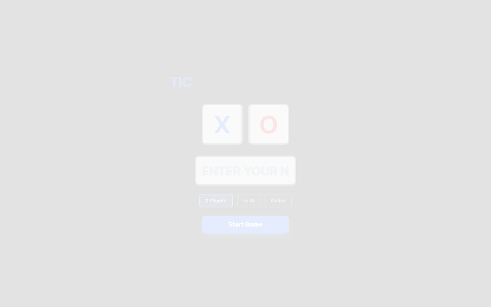
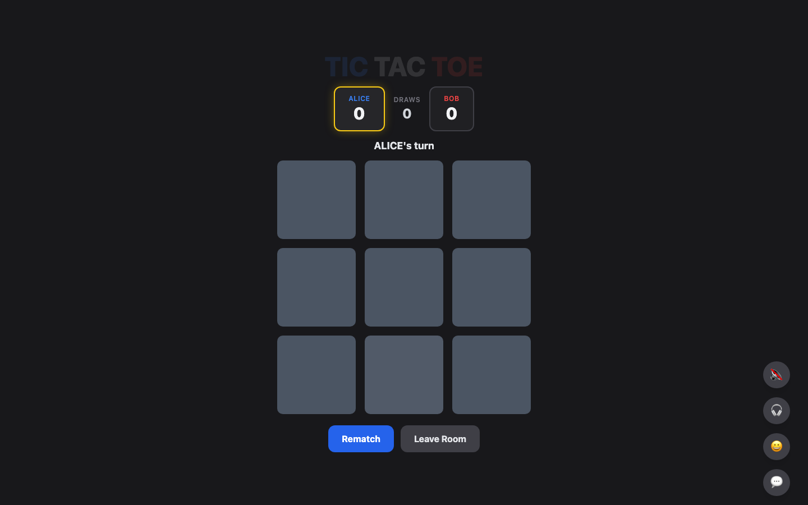
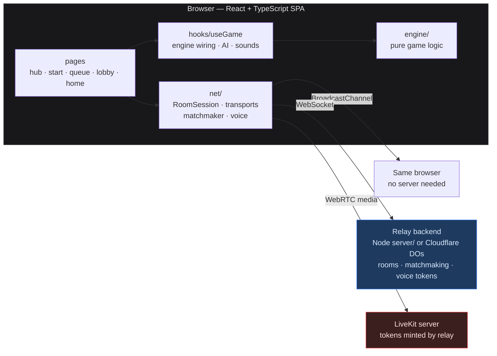

# Arcade Hub

[](https://github.com/nahyan0077/arcade-hub/actions/workflows/ci.yml)
[](LICENSE)

A browser **arcade game app** that currently ships a polished **tic-tac-toe** as its flagship
game — with more games planned on the same stack. Play local hot-seat, face an unbeatable AI,
or go online with room codes, Quick Play matchmaking, in-game chat, and live voice chat.
Built test-first, phase by phase, on a game-scoped networking layer.

<p align="center">
  
  &nbsp;
  
</p>

## Contents

- [Features](#features)
- [Quick start](#quick-start)
- [Scripts](#scripts)
- [Architecture](#architecture)
- [Configuration](#configuration)
- [Testing](#testing)
- [Known limitations](#known-limitations)
- [Roadmap](#roadmap)
- [Contributing](#contributing)

## Features

- **Game hub** — the landing page is an arcade picker; more games are planned on the same stack
- **2-Player local** — hot-seat play with persistent X/O/draw scores
- **vs AI** — four difficulty tiers, each with its own personality:

  | Difficulty | Personality | Behavior |
  |-----------|-------------|----------|
  | Easy | GLITCH | random moves (seeded RNG) |
  | Medium | SCOUT | takes wins, blocks threats, prefers center |
  | Hard | VANGUARD | lookahead minimax (depth 4) |
  | Impossible | NEMESIS | full minimax + alpha-beta — proven unbeatable |

- **Online rooms** — create/join with 6-character codes over WebSocket, or **Quick Play**
  matchmaking; perspective-aware results ("You win!" / "You lose!") that celebrate only on
  the winner's side
- **In-game chat & emoji** — a slide-up chat panel plus a standalone quick-reactions bar
  (🎉🔥😂👏💯😅🤔👀) with floating bursts on both sides; works over every transport
  including BroadcastChannel
- **Voice chat** — LiveKit-powered per-room audio behind icon controls (🎧 join, 🎤 mute,
  participant count badge), listen-only until you unmute
- **Coach hints** — pulsing highlight on the mathematically best cell
- **Synthesized sounds** — place/win/lose/draw/invalid effects via the Web Audio API (no
  audio assets); mute persists across reloads
- **Responsive & accessible** — fits any viewport without scrolling; keyboard-navigable
  cells, ARIA labels, live status region

## Quick start

```bash
npm install
npm run dev              # http://localhost:5173 — local and vs-AI work immediately
```

| Play mode | How |
|-----------|-----|
| Local hot-seat / vs AI | just `npm run dev` |
| Online, same browser | open two tabs — no `VITE_WS_URL` means in-browser BroadcastChannel (same profile and origin) |
| Online, across devices | `npm run relay`, then `VITE_WS_URL=ws://localhost:8787 npm run dev` |
| Cloudflare-style relay locally | `npm run relay:cf` (:8788) with `VITE_WS_URL=ws://localhost:8788` |
| Play live (hosted) | **https://arcade-hub-relay.arcade-hub.workers.dev** |
| Voice chat | see [Voice chat](#voice-chat) — needs LiveKit + a relay with `LIVEKIT_*` vars |

## Scripts

| Command | Description |
|---------|-------------|
| `npm run dev` | start dev server |
| `npm run build` | type-check + production build |
| `npm run lint` | ESLint |
| `npm test` | unit + integration tests (Vitest) |
| `npm run test:watch` · `test:ui` · `test:coverage` | Vitest variants |
| `npm run test:e2e` | Playwright E2E over BroadcastChannel (desktop + mobile) |
| `npm run test:e2e:ws` | E2E online + matchmaking over the Node WebSocket relay |
| `npm run test:e2e:cf` | E2E over the Cloudflare Durable Object relay (wrangler dev) |
| `npm run test:e2e:voice` | E2E voice session against a throwaway dockerized LiveKit |
| `npm run relay` | room relay server (ws, port 8787) |
| `npm run relay:cf` | Cloudflare Durable Object relay via wrangler dev (port 8788) |
| `npm run typecheck:cf` | type-check the Cloudflare worker |
| `npx wrangler deploy` | deploy worker + SPA assets to Cloudflare (after a build) |

## Architecture



Key decisions:

- **Pure-TS engine** — no React/DOM imports; exhaustively tested, reusable by future games
- **One `RoomTransport` interface** — the same `RoomSession` runs on BroadcastChannel, the
  Node relay, and Cloudflare Durable Objects
- **Dumb fan-out relays** — state lives in the clients (who validate moves); simple, but a
  tampered client can cheat (see [Known limitations](#known-limitations))
- **Game-scoped ids** — rooms, queues, and voice rooms are keyed `<game>:<code>`, so a second
  game reuses the whole networking stack

Full diagrams, HLD/LLD, data flows, and invariants: **[docs/ARCHITECTURE.md](docs/ARCHITECTURE.md)**.

### Project structure

```text
src/
  engine/        pure game logic — rules, minimax AI, personalities
  net/           protocol · transports · RoomSession · matchmaker · voice
  hooks/         useGame — engine wiring, AI scheduling, sounds, scores
  pages/         hub · start · queue · lobby · home
  components/    Board · VoiceControls · ChatPanel · QuickEmoji · EmojiBurstLayer
  sound/         Web Audio synth effects + persisted mute
  storage/       validated localStorage score persistence
server/relay.ts  Node ws relay — room fan-out, /matchmake, /voice/token
cloudflare/      Worker + RoomRelay and Matchmaker Durable Objects
scripts/         LiveKit config + voice E2E orchestration
e2e/             Playwright specs (desktop Chromium + iPhone WebKit)
docs/            architecture guide + README images
```

## Configuration

| Env var | Default | Purpose |
|---------|---------|---------|
| `VITE_AI_DELAY_MS` | `600` | AI "thinking" delay before it moves |
| `VITE_WS_URL` | unset | WebSocket relay base URL; unset = in-browser BroadcastChannel |
| `RELAY_PORT` | `8787` | relay server port |
| `LIVEKIT_URL` | unset | LiveKit ws URL (e.g. `ws://127.0.0.1:7880`); unset disables voice (`503 voice-unconfigured`) |
| `LIVEKIT_API_KEY` / `LIVEKIT_API_SECRET` | unset | LiveKit API credentials for minting join tokens (secret ≥ 32 chars) |

### Voice chat

Voice is off by default: the room page hides voice controls without `VITE_WS_URL`, and the
relay returns `503 voice-unconfigured` unless the `LIVEKIT_*` vars are set. To enable locally:

1. Start a dev LiveKit server (the secret in `scripts/livekit.yaml` must be ≥ 32 characters):

   ```bash
   docker run --rm -p 7880:7880 -p 7881:7881/tcp -p 50000-50100:50000-50100/udp \
     -e NODE_IP=127.0.0.1 -v "$PWD/scripts/livekit.yaml":/lk/livekit.yaml:ro \
     livekit/livekit-server --config /lk/livekit.yaml
   ```

2. Export `LIVEKIT_URL=ws://127.0.0.1:7880` and `LIVEKIT_API_KEY`/`LIVEKIT_API_SECRET`
   (matching the config file) before `npm run relay`. For `npm run relay:cf`, copy
   `.dev.vars.example` to `.dev.vars` instead.

`npm run test:e2e:voice` wraps steps 1–2: it starts a throwaway container, runs the
two-player voice E2E, and removes the container. Joining starts **listen-only** — the
microphone is only requested when you unmute.

**Cross-device voice on one Wi-Fi network** — point LiveKit at your machine's LAN address
instead of loopback (an `https` page cannot open `ws://127.0.0.1`, and cloudflared quick
tunnels cannot proxy LiveKit's UDP media ports):

1. Start LiveKit with `NODE_IP=<your-lan-ip>` (ports unchanged).
2. Set `LIVEKIT_URL=ws://<your-lan-ip>:7880` for the relay — this value is returned to
   clients in the token response, so it must be reachable from the other device.
3. Serve the app on the LAN too: `npx vite --port 5173 --host`, then open
   `http://<your-lan-ip>:5173` on both devices.

For devices across the internet, use a hosted LiveKit (e.g. LiveKit Cloud) and set
`LIVEKIT_URL`/keys accordingly.

## Testing

- **Engine** — exhaustive rules tests plus seeded 100-game properties (AI never loses;
  impossible-vs-impossible always draws)
- **Integration** — Hub/Start/Home flows through real components with mocked Web Audio and
  localStorage
- **E2E** — Playwright on desktop Chromium and iPhone WebKit: hub, win/draw/rematch, vs-AI,
  hints, mute silencing (oscillator-level assertion), viewport fit, online play over
  BroadcastChannel / Node relay / Cloudflare DO relay, Quick Play matchmaking, in-game chat
  and emoji, voice-unavailable fallback, and a two-player voice session against dockerized
  LiveKit
- **CI** — lint, build, type-check, unit, and the BroadcastChannel + WebSocket E2E suites on
  every push ([`.github/workflows/ci.yml`](.github/workflows/ci.yml)); the voice and CF
  suites need docker/wrangler and run locally

## Deployment

One Cloudflare Worker serves everything on a single origin
([`arcade-hub-relay.arcade-hub.workers.dev`](https://arcade-hub-relay.arcade-hub.workers.dev)):

- static SPA assets (`dist/`, SPA fallback) — the page you play on
- `ws(s)://…/room/<code>` and `/matchmake` — Durable Object relays
- `POST /voice/token` — LiveKit token minting (returns `503` until configured)

Redeploy:

```bash
VITE_WS_URL=wss://arcade-hub-relay.arcade-hub.workers.dev npm run build
npx wrangler deploy
```

**Continuous deployment** — pushes to `main` run the full CI battery and, when the
`CLOUDFLARE_API_TOKEN` and `CLOUDFLARE_ACCOUNT_ID` repository secrets are set, auto-deploy
via the `deploy` job in [`.github/workflows/ci.yml`](.github/workflows/ci.yml). Without the
secrets the deploy step is skipped.

Voice on the deployed relay needs hosted LiveKit credentials:

```bash
npx wrangler secret put LIVEKIT_URL        # wss://<project>.livekit.cloud
npx wrangler secret put LIVEKIT_API_KEY
npx wrangler secret put LIVEKIT_API_SECRET
```

## Known limitations

- Relays are **not authoritative** — both clients validate moves, but a modified client can
  cheat its peer
- `playerId` is client-generated (spoofable); rate limits are per-instance and in-memory
  (reset on restart, not distributed — no per-IP limit on the CF voice endpoint)
- Online scores are session-only (no persistence); no reconnect-resume

## Roadmap

| Phase | Status |
|-------|--------|
| 1 — Core game logic and polish | ✅ |
| 2 — AI opponent and coach hints | ✅ |
| 3 — Online presence (lobby, BroadcastChannel) | ✅ |
| 4 — WebSocket transport + Node relay | ✅ |
| 5 — Cloudflare Durable Object relay | ✅ |
| 5b — Persistence (Neon/Upstash) | deferred until a real need |
| 6 — Quick Play matchmaking + voice (LiveKit) | ✅ |
| 7a — Game hub landing page | ✅ |
| 7b — Game-scoped networking (`<game>:<code>`) | ✅ |
| 7c — Second game on the shared stack | planned |
| Deployment (Cloudflare worker + SPA) | ✅ |
| Hosted voice (LiveKit Cloud secrets) | ✅ |
| Continuous deployment (wrangler on push) | ✅ |

## Contributing

Contributions welcome — see [CONTRIBUTING.md](CONTRIBUTING.md) for setup, the quality gates
every change must pass, and the checklist for adding a new game.

## License

[MIT](LICENSE)
