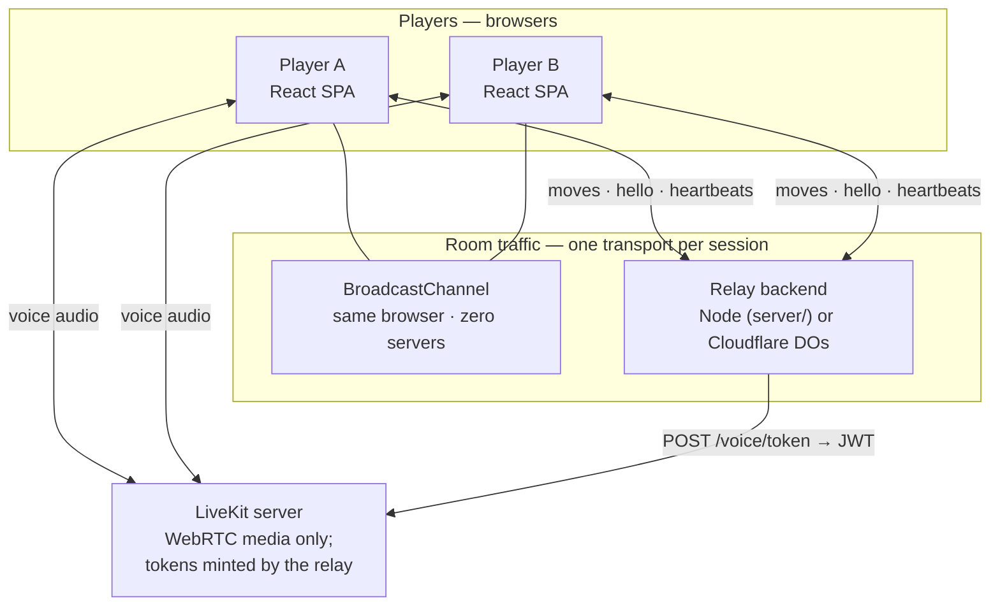
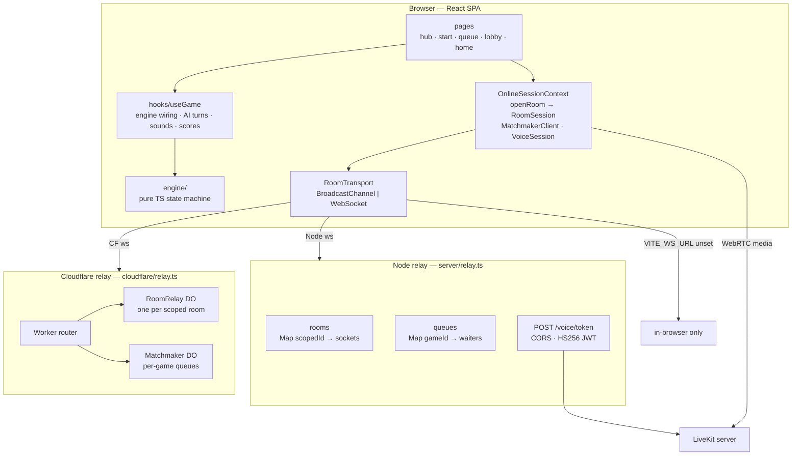
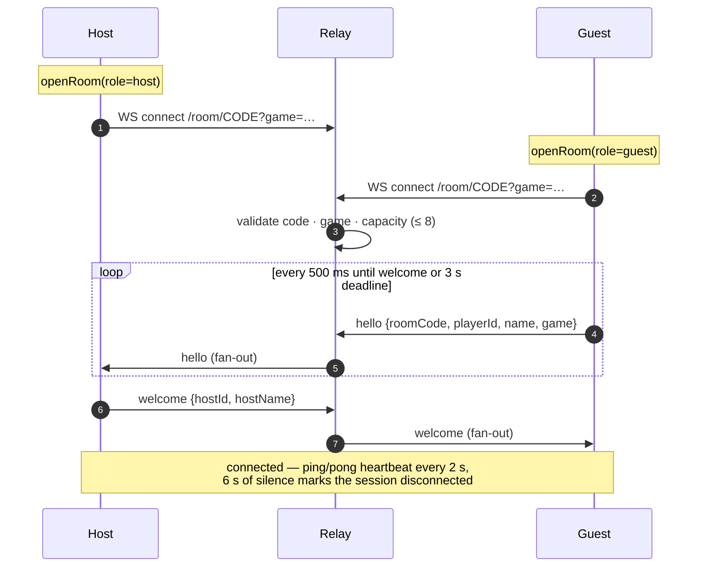
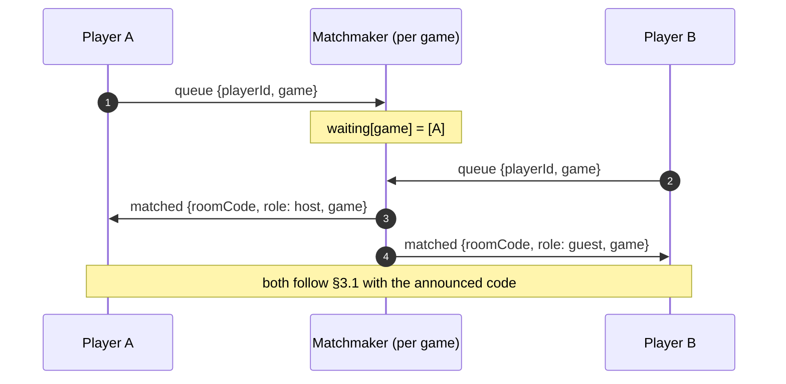
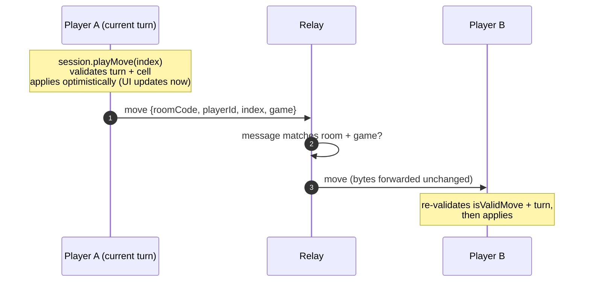
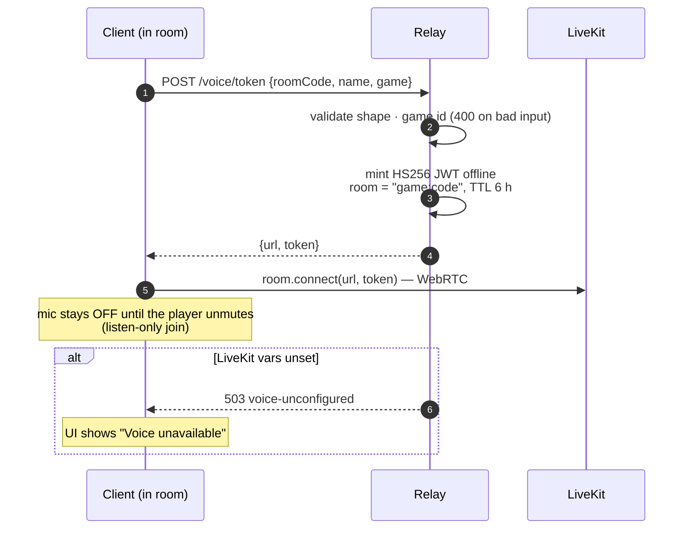
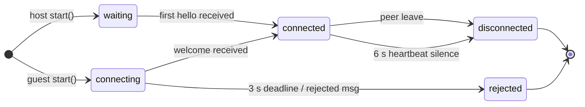

# Architecture

How Arcade Hub is put together: system context, high-level design (HLD),
low-level design (LLD), data flows, invariants, and how to extend it.

## Contents

1. [System context](#1-system-context)
2. [High-level design (HLD)](#2-high-level-design-hld)
3. [Data flows](#3-data-flows)
4. [Low-level design (LLD)](#4-low-level-design-lld)
5. [Invariants and failure modes](#5-invariants-and-failure-modes)
6. [Testing architecture](#6-testing-architecture)
7. [Security posture](#7-security-posture)
8. [Scaling and deployment](#8-scaling-and-deployment)
9. [Extending: adding a game](#9-extending-adding-a-game)

## 1. System context

Two players never talk to each other directly over the internet: every room message flows
through **one** transport. Voice media goes peer-to-peer over WebRTC; the relay only mints
join tokens.

## 2. High-level design (HLD)

The two relays are **behavioral twins** behind the same wire protocol — the Node relay exists
for simple self-hosting and tests; the Cloudflare version is the deploy target (Durable
Objects give per-room and per-queue state with hibernation).

### Key design decisions

| Decision | Rationale |
|----------|-----------|
| Pure-TS engine, no framework imports | exhaustive unit tests, property-based AI proofs, reuse by future games |
| Transport behind a `RoomTransport` interface | the same `RoomSession` runs on BroadcastChannel, Node ws, and CF DOs |
| Relay is a dumb fan-out (not authoritative) | simplicity; state lives in clients who already validate moves. Trade-off: a modified client can cheat (§7) |
| Game-scoped ids (`<game>:<code>`) everywhere | rooms, queues, and LiveKit rooms isolated per game; adding a game doesn't touch transports |
| Voice tokens minted by the relay | LiveKit secrets never reach the browser; one env-var set per deployment |

## 3. Data flows

### 3.1 Create / join a room

- A second, different guest triggers `rejected {reason: room-full}` from the host.
- The guest's join window closes into `rejected` if no host answers (unknown code case).

### 3.2 Quick Play matchmaking

Queues are keyed by game id — players queueing for different games never pair. The client
times out after 30 s locally and sends `cancel`.

### 3.3 A move

The sender never waits for the wire to update its own board (optimistic UI); the receiver
re-validates before applying. The relay is a byte fan-out with a scoping check.

### 3.4 Voice join

## 4. Low-level design (LLD)

### 4.1 Protocol (`src/net/protocol.ts`)

Room messages (over any transport; `game` optional, defaults to `tictactoe`):

| Type | Direction | Payload |
|------|-----------|---------|
| `hello` | guest → host | `roomCode, playerId, name, game?` |
| `welcome` | host → guest | `roomCode, hostId, hostName, game?` |
| `rejected` | host → guest | `roomCode, reason: not-found \| room-full` |
| `move` | either | `roomCode, playerId, index, game?` |
| `rematch` / `rematch-start` | either / host | `roomCode, playerId?` |
| `leave` | either | `roomCode, playerId` |
| `ping` / `pong` | either (heartbeat) | `roomCode, playerId` |

Matchmaker messages (JSON over its own WebSocket):

| Type | Direction | Payload |
|------|-----------|---------|
| `queue` / `cancel` | client → server | `playerId, game?` |
| `matched` | server → client | `playerId, roomCode, role, game?` |
| `queue-timeout` | server → client | `playerId` |

**Room codes** — 6 characters from `ABCDEFGHJKMNPQRSTUVWXYZ23456789` (no I/L/O/1).

**Scoped room id** — `scopedRoomId(game, code)` → `"tictactoe:ABC234"`, used as:

- the relay room key (both backends)
- the BroadcastChannel suffix (`room:<scopedId>`)
- the Durable Object `idFromName` input
- the LiveKit room name inside minted tokens

### 4.2 RoomSession state machine (`src/net/RoomSession.ts`)

Owns one room membership: handshake, heartbeats, move/rematch application, teardown.
Snapshot (`status, role, roomCode, game, myId, myName, myMark, opponentName, state,
rematchRequested`) is replaced immutably; subscribers get a fresh object per change.

- Every outbound message is stamped with the session's `game`; inbound messages with a
  foreign `game` or room code are dropped before touching state.
- Rematch: both sides send `rematch`; when the host has seen both, it emits `rematch-start`
  and restarts.

### 4.3 Transports (`src/net/transport.ts`, `wsTransport.ts`, `createRoomTransport.ts`)

| Transport | Selected when | Notes |
|-----------|---------------|-------|
| BroadcastChannel `room:<game>:<code>` | `VITE_WS_URL` unset | same browser profile + origin only (incognito is a separate partition) |
| WebSocket `<VITE_WS_URL>/room/<code>?game=…` | `VITE_WS_URL` set | posts buffer in an outbox until the socket opens |

Missing `game` on the relay side means the default game, so older clients interop.

### 4.4 Node relay (`server/relay.ts`)

| Piece | Design |
|-------|--------|
| `rooms` | `Map<scopedId, Set<ws>>`; fan-out with scoping check; `1013` on >8 members (refused before handshake), `1008` on unknown code/game |
| `queues` | `Map<gameId, waiters[]>` — FIFO per game; `matched` echoes the game |
| HTTP | `GET /` health text; `POST /voice/token` — CORS-enabled, `503` when unconfigured, `404 room-not-found` when the room has no live members, `429` past the per-IP voice-token limit, `400` on malformed body (including unknown `game`) |
| Forward validation | JSON-parse, ≤ 4 KB, and `scopedRoomId(msg.game, msg.roomCode)` must equal the connection's room |
| Rate limits | 60 messages / 5 s per socket (`1008 rate limited`); 10 sockets per IP (`1013`); 30 voice-token POSTs / min per IP (`429`); `maxRooms` cap (`1013`) — defaults overridable via `startRelay(_, {limits})` |

### 4.5 Cloudflare relay (`cloudflare/relay.ts`)

| Durable Object | State | Behavior |
|----------------|-------|----------|
| `RoomRelay` — one per scoped room id | per-socket `serializeAttachment({roomId})`; membership via `state.getWebSockets()` — survives hibernation | same fan-out + validation as Node; room-full refused **pre-handshake** (`503`) because workerd does not deliver a post-accept `close()` to the peer; 60 msgs / 5 s per socket (`1008`) |
| `Matchmaker` — one, `idFromName('global-queue')` | `serializeAttachment({queued, playerId, game})` — survives hibernation | pairs only equal-game waiters; waiting cap 500; same per-socket message limit |

Per-socket state lives in WebSocket attachments (not class fields) because hibernation
destroys the DO instance — anything in memory is lost when an idle room wakes up.
`GET /__membership` (internal, not routed publicly) reports the live-member count so the
worker can refuse voice-token mints for dead rooms.

The Worker validates the `game` query param and computes `idFromName(scopedRoomId(...))`,
so isolation is enforced by DO identity — not just by message inspection.

### 4.6 Voice (`src/net/voiceToken.ts`, `voiceSession.ts`, `livekitVoiceRoom.ts`)

- **Tokens** — HS256 JWT via Web Crypto (shared by Node relay, CF worker, and tests):
  `iss` = API key, `sub` = identity UUID, `name`, `video: {room: "<game>:<code>",
  roomJoin, canPublish, canSubscribe, canPublishData}`, TTL 6 h with 10 s clock-skew allowance.
- **`VoiceSession`** — join = POST token → dynamic-import the LiveKit SDK → connect
  listen-only; mic enabled only on explicit unmute. Statuses: `off | connecting | live | error`.
- The LiveKit room name is the scoped id, so two future games with the same code never
  share audio.

### 4.7 Engine (`src/engine/`)

`createInitialState → startGame → makeMove → …` is a pure reducer-style state machine
(`phase: playing | finished`, win lines, scores, move history). The AI (`ai.ts`) is
deterministic under an injected `rng`, which is what lets tests prove seeded properties
("NEMESIS never loses over 100 games").

## 5. Invariants and failure modes

| Invariant / behavior | Enforced by |
|----------------------|-------------|
| A cell can be played only on an empty cell of a `playing` game, by the current player | `engine/core.ts` (`isValidMove`) — checked by sender **and** receiver |
| Never more than two room members; a third joiner is rejected | host (`room-full`) or relay (capacity refusal) |
| Orphaned sessions die | heartbeats (2 s), timeout (6 s), guest hello deadline (3 s) |
| A room id belongs to exactly one game | scoped keys at every layer — transport, relay map, DO name, LiveKit room |
| Unknown game ids never join or match | parsers return `null`; relays close/refuse; voice token `400` |
| Voice is unavailable, not broken, when unconfigured | `503 voice-unconfigured` → "Voice unavailable" UI keeps the join button visible |
| Voice tokens only exist for live rooms | `404 room-not-found` when the scoped room has no open relay sockets |
| Flooding sockets get closed, not queued | per-socket message windows (`1008 rate limited`) on both relays |

## 6. Testing architecture

| Layer | Tooling | What it proves |
|-------|---------|----------------|
| Engine | Vitest (node) | rules, win detection, seeded AI properties |
| Net units | Vitest + fake transports/sockets | handshake, heartbeats, rematch, game scoping, matchmaker parsing |
| Relay integration | Vitest (node env, real `ws` server on an ephemeral port) | fan-out, queue pairing, voice token minting |
| UI integration | Vitest + jsdom + Testing Library | Start/Hub/Home flows, perspective copy, mute, dialogs |
| E2E | Playwright — desktop Chromium + iPhone WebKit | full products: BroadcastChannel, Node relay, CF relay (wrangler dev), voice (docker LiveKit) |

CI ([`.github/workflows/ci.yml`](../.github/workflows/ci.yml)) runs lint → build →
type-check → unit → BroadcastChannel E2E → ws E2E. The voice and CF suites need heavier
local setup: `npm run test:e2e:voice`, `npm run test:e2e:cf`.

> **Local gotcha:** Playwright reuses whatever is already listening on the suite's port.
> Kill a manually started relay — especially one with `LIVEKIT_*` set, which breaks the
> "voice unavailable" fixture — before `npm run test:e2e:ws`.

## 7. Security posture

- **Not authoritative** — the relay forwards whatever the clients agree on; both clients
  validate moves, but a tampered client can cheat its peer. Making the relay authoritative
  is a known future step (the engine state machine is already pure, so the surface is small).
- **`playerId` is client-generated** (a UUID held in memory) — spoofable; fine for a game,
  not for identity.
- **Voice tokens require membership** — `/voice/token` only mints when the scoped room has
  live relay sockets (Node checks its `rooms` map; the CF worker asks the `RoomRelay` DO via
  `__membership`). A caller who knows a code for a dead room gets `404`.
- **Rate limiting is per-instance and in-memory** — per-socket message windows, per-IP
  socket/voice-token caps on the Node relay, per-socket windows and a waiting cap on the CF
  DOs. Limits reset on restart/hibernation and aren't distributed (fine for friends-scale;
  use platform edges/WAF for harsher abuse). The CF worker has no per-IP HTTP limit on
  `/voice/token` (no cheap shared counter); the membership check bounds its usefulness.
- No auth, no persistence; LiveKit secrets live only in relay env vars (never shipped to
  the browser).

## 8. Scaling and deployment

- **Production is one Cloudflare Worker on a single origin**
  (`arcade-hub-relay.arcade-hub.workers.dev`): static SPA assets (with SPA fallback) +
  the HTTP/WS relay surface + Durable Objects for rooms and matchmaking. One origin means
  the app, its relay, and (once configured) voice tokens share a host — no CORS, one URL
  to deploy. Redeploy = `VITE_WS_URL=wss://arcade-hub-relay.arcade-hub.workers.dev npm run
  build && npx wrangler deploy`.
- Scales by construction — one DO per room, hibernation-safe attachment state — bounded by
  wrangler/account quotas. Hosted voice: `wrangler secret put LIVEKIT_URL / LIVEKIT_API_KEY
  / LIVEKIT_API_SECRET` (LiveKit Cloud); until then `/voice/token` answers `503` and the UI
  shows "Voice unavailable".
- The Node relay remains the local/dev path: single-node, in-memory, fine for friends-scale
  traffic; a restart drops rooms (clients see `disconnected` and can rejoin).
- LiveKit media never touches the relays.
- Persistence (scores, rejoin) is deliberately deferred; the seam would be the relay or a
  small KV/Postgres behind room creation and `/matchmake`.

## 9. Extending: adding a game

The networking seam from Phase 7b:

1. Add the id to `GAMES` in `src/net/protocol.ts` — everything else type-checks against it.
2. Build the game as a pure engine module (mirror `src/engine/`).
3. Hub (`src/pages/hub/Hub.tsx`): make the card playable and navigate to `/start` with the
   game id in router state; Start threads it into `openRoom` / `MatchmakerClient` /
   `VoiceSession`.
4. Add a page like `home/` that drives the engine through `RoomSession` (or a sibling
   session type if the rules need different messages — add variants to `RoomMessage` and
   keep `game` stamped).
5. Add engine + page tests and one E2E happy path. Relays and voice need no changes.
